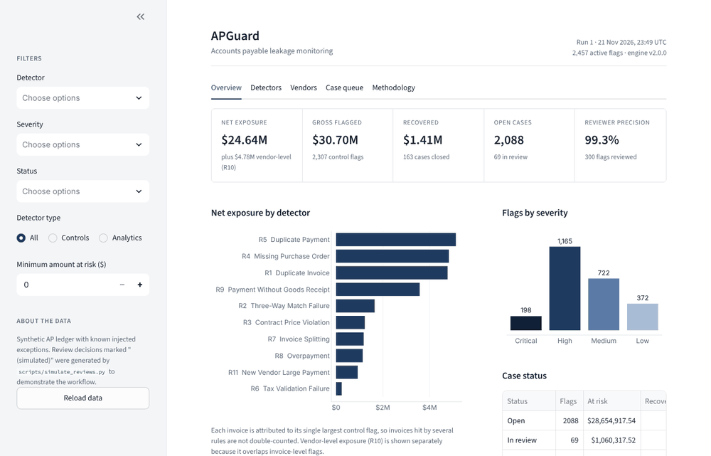
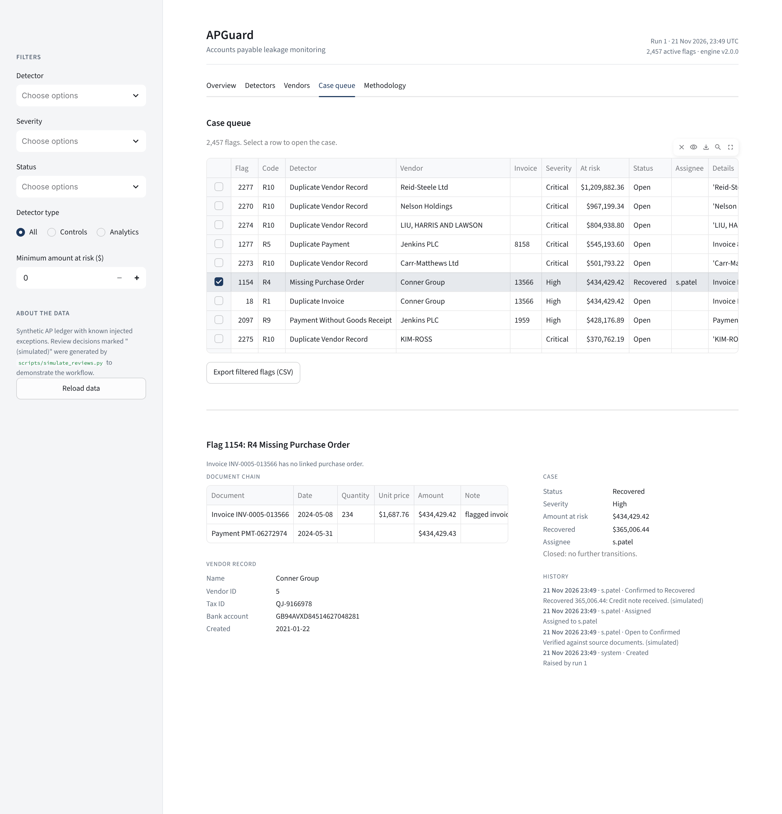
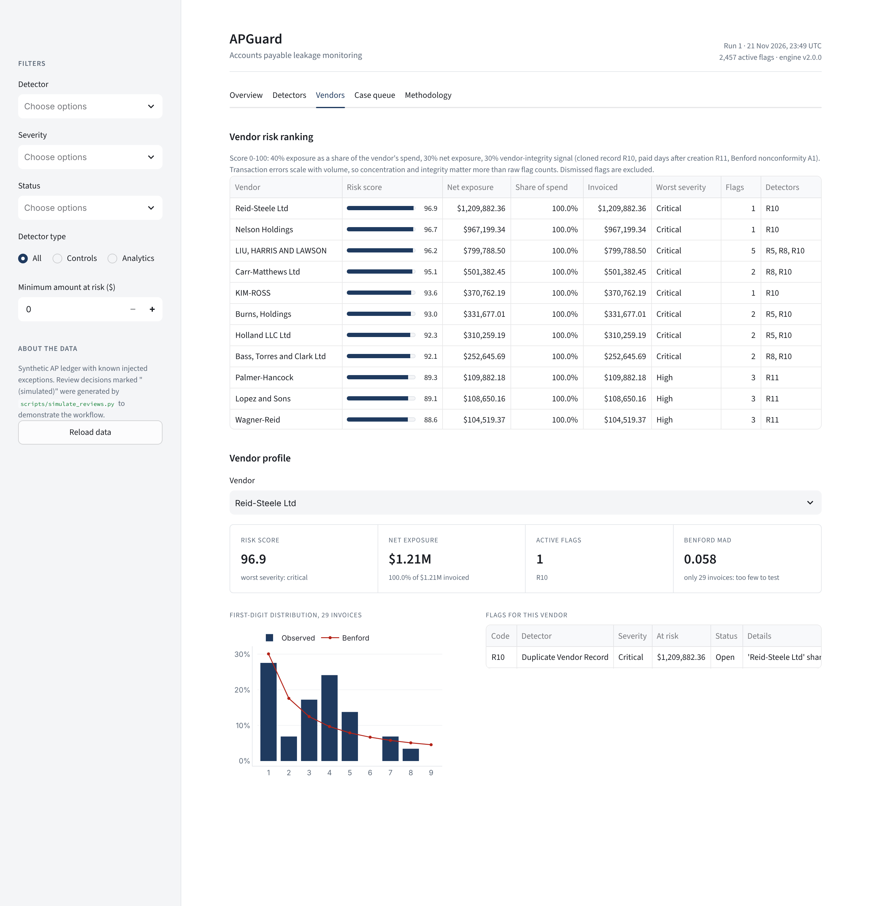
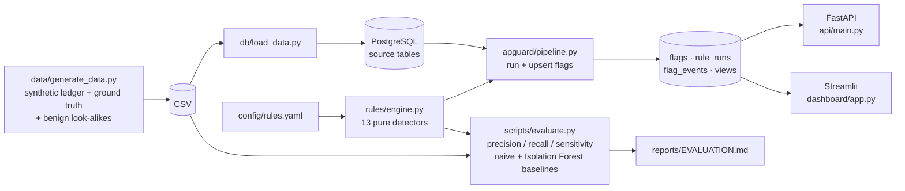

# APGuard

**Accounts payable leakage detection, with an honest evaluation.**

APGuard checks a linked AP ledger (vendors, contracts, purchase orders, goods receipts, invoices and payments) for duplicate billing, three-way match failures, off-contract pricing, payments without receipts, vendor master fraud and more. Every flag goes into a review queue with its full document chain and an audit trail. The detectors are scored for precision and recall against a synthetic ledger that contains both known exceptions and legitimate transactions designed to look suspicious.

[](https://github.com/smitkohale/APGuard/actions/workflows/ci.yml)

**Read the write-up:** [Building and evaluating an AP leakage detector](docs/CASE_STUDY.md) · **Evaluation report:** [reports/EVALUATION.md](reports/EVALUATION.md)

### Live demo

**Dashboard:** https://apguard.streamlit.app · **API docs:** https://apguard.onrender.com/docs

If the app is asleep, click **"Yes, get this app back up!"** and give it about 30 seconds. Both run on free tiers: the dashboard sleeps after 12 hours without visitors, and the API takes about a minute to start after 15 idle minutes. Reviews are disabled on the public dashboard.



Python · pandas · PostgreSQL · SQLAlchemy · FastAPI · Streamlit · Plotly · scikit-learn · pytest · Hypothesis · Docker · GitHub Actions

---

## Results at a glance

On 54,514 synthetic records with 2,420 injected exceptions and 1,420 legitimate look-alikes ([full report](reports/EVALUATION.md)):

| | |
|---|---|
| Detectors | 11 control rules + 2 statistical analytics |
| Control rules | ≥ 96% precision and 100% recall on every rule |
| Look-alikes wrongly flagged | **0 of 1,663** (the naive version flagged 676) |
| Injected leakage on flagged items | 100% of $24.6M |
| Full run, 13,875 invoices | 0.8 s (the original row-by-row engine: 4.1 s for 9 rules) |
| Tests | 102 (unit, property-based, evaluation regression, Postgres integration) |

### What the extra logic buys

`rules/baseline.py` contains the naive versions of the rules: exact-match duplicates that flag both copies, per-invoice three-way matching, contracts looked up without dates, and splitting checks that don't know about partial deliveries. This is how the first version of this project worked. Both versions are scored on the same data:

| Rule | Naive precision | APGuard precision | Naive recall | APGuard recall | What changed |
|---|---:|---:|---:|---:|---|
| R1 Duplicate invoice | 13.0% | **96.2%** | 57.4% | **100%** | flag only the later copy; normalise invoice numbers; amount tolerance; catch duplicates re-keyed without the PO; ignore partial deliveries |
| R2 Three-way match | 26.4% | **100%** | 100% | 100% | reconcile per PO, not per invoice; exclude same-PO duplicates |
| R3 Contract price | 50.1% | **100%** | 100% | 100% | use the contract in force on the invoice date |
| R7 Invoice splitting | 84.1% | **100%** | 100% | 100% | ignore duplicates and delivery-backed partial billing |
| R6, R8 | 100% | 100% | 100% | 100% | no change needed. Not every rule gains anything, and the report says so |

### Where the trade-offs are

Not every setting is a free win. The report sweeps the key thresholds:

- **Re-keyed duplicates (R1).** Matching duplicates across *different* POs as well as missing ones raises recall on re-keyed resubmissions, but precision falls from 96% to 46%. The default only matches when one side has no PO.
- **Price outliers (A2).** Without a floor on the spread estimate, a SKU bought mostly under one tight contract turns every normal market-rate purchase into an "outlier": precision is 11%. With a 5% floor it is 82%, and most of the remaining "false positives" are real contract-price violations.
- **Rules vs machine learning.** An Isolation Forest over generic invoice features, given the same alert budget, gets 63% precision against 99.8% for the rules. It misses most contract and quantity problems. But it catches 94% of the inflated non-contract prices that no rule targets. That gap is why the A2 analytic exists.

---

## How the evaluation stays honest

Grading rules against the same generator that planted the exceptions is easy to game, so three things are built in:

1. **Legitimate look-alikes.** The generator adds activity that a careless rule would flag: partial deliveries (several receipts and matching invoices on one PO), monthly recurring billing for identical amounts, mid-term contract price increases, cent-level tax and payment rounding, and new vendors onboarded properly. These are logged separately and every false positive on them is counted.
2. **Hard cases with real trade-offs.** Some duplicates are re-keyed without their PO reference, so catching them requires a looser match that collides with recurring billing. Natural receipt variance (a delivery of 98 when 100 were ordered) is included as a genuine three-way mismatch.
3. **A naive baseline and an unsupervised baseline.** Precision and recall mean little without something to compare against.

The [limitations](#limitations) section covers what this still can't show.

---

## Detectors

| Code | Detector | Control tested | Assertion |
|---|---|---|---|
| R1 | Duplicate invoice | Duplicate invoice prevention | Occurrence |
| R2 | Three-way match failure | PO / goods receipt / invoice match | Accuracy |
| R3 | Contract price violation | Contract price compliance | Valuation |
| R4 | Missing purchase order | No PO, no pay | Authorization |
| R5 | Duplicate payment | Duplicate payment prevention | Occurrence |
| R6 | Tax validation failure | Tax / VAT validation | Accuracy |
| R7 | Invoice splitting | Approval limits, segregation of duties | Authorization |
| R8 | Overpayment | Payment accuracy | Accuracy |
| R9 | Payment without goods receipt | Receipt before payment | Existence |
| R10 | Duplicate vendor record | Vendor master data integrity | Occurrence |
| R11 | New vendor large payment | Vendor onboarding and due diligence | Existence |
| A1 | Benford nonconformity | Forensic analytics: first-digit test (chi-square + Nigrini MAD) | Occurrence |
| A2 | Unit price outlier | Forensic analytics: robust z-score on log price per SKU | Valuation |

Each detector is a pure function over DataFrames (`rules/engine.py`), vectorised with merges and group-bys, and configured from [`config/rules.yaml`](config/rules.yaml). Every run stores a snapshot of that config, so any flag can be traced to the thresholds that produced it.

**Exposure is de-duplicated.** One invoice can trip several rules: a duplicate keyed without a PO is both R1 and R4. Gross exposure sums every flag ($30.7M here). Net exposure keeps the largest control flag per invoice ($24.6M). Vendor-level exposure (R10) is reported separately because it overlaps invoice-level flags.

---

## Review workflow



Flags move through `open → in_review → confirmed → recovered`, or to `false_positive`. Dismissing a flag requires a note, and recording a recovery requires an amount. Every action is written to an append-only `flag_events` table. Flags have a stable identity (`rule|vendor|invoice|payment`), so re-running detection never wipes review work: existing flags keep their status, new ones are added, and flags a later run no longer reproduces drop out of the active view while keeping their history.

Each case shows its evidence: the contract in force, the PO, every goods receipt, every invoice on the PO (for duplicates, the likely original too) and every payment. Reviewer decisions feed an observed-precision figure per detector. That is the number that matters once real data is involved.

The vendor ranking combines exposure as a share of spend, dollar exposure, and vendor-integrity signals (R10, R11, A1). Ranking by flag count or worst severity just puts the largest suppliers first, because transaction errors scale with volume. The blended score ranks all 20 injected cloned and shell vendors in the top 20.



---

## Architecture



| Path | Purpose |
|---|---|
| `rules/` | detectors, registry (control and assertion mapping), config loader, naive baseline |
| `apguard/` | application layer shared by the API, dashboard and scripts: DB access, runs, workflow, evidence, metrics, evaluation |
| `db/schema.sql` | normalised schema with constraints, workflow tables, and views (active flags, net exposure, three rules re-implemented in SQL) |
| `api/` | REST API |
| `dashboard/` | Streamlit app |
| `scripts/` | `run_pipeline.py`, `evaluate.py`, `benchmark.py`, `simulate_reviews.py` |
| `tests/` | unit, property-based, evaluation regression and integration tests |

### API

| Method | Path | |
|---|---|---|
| GET | `/flags` | filter by rule, severity, status, type, vendor, amount; paginated with a true `total` |
| GET | `/flags/summary` | gross and net exposure, recoveries, status counts, observed precision, per-rule breakdown |
| GET | `/flags/{id}` | flag plus full evidence chain and audit trail |
| PATCH | `/flags/{id}` | review action (status, assignee, note, recovered amount). Requires `X-API-Key` |
| GET | `/flags/export.csv` | filtered export |
| GET | `/vendors/risk-ranking`, `/vendors/{id}` | ranking and drill-down |
| GET / POST | `/runs` | run history / trigger a run (POST requires a key) |
| GET | `/rules`, `/evaluation`, `/health` | detector register, latest evaluation, liveness |

Request and response models are typed with Pydantic, and enum parameters are validated. If `APGUARD_API_KEY` is not set, write endpoints are disabled rather than left open.

---

## Engineering decisions and lessons

**Duplicate payments and SQL row order.** R5 originally skipped the first payment per invoice by position, assuming rows arrived in `payment_id` order. SQL guarantees no order without `ORDER BY`, so the original payment was sometimes flagged instead of the duplicate. Recall was 47%. The rule now sorts explicitly by payment date and ID, and a test feeds rows in reverse order.

**Three-way match had to move from per-invoice to per-PO.** Comparing each invoice to the PO quantity flags every instalment of a partial delivery. Reconciling *total* invoiced quantity per PO against ordered and received quantity removes all 400 partial-delivery false positives without losing recall. A PO with no receipt at all is left to R9, so the two rules never report the same root cause twice.

**The generator had bugs too.** The first invoice-splitting injection divided the pre-tax amount, so some "split" pieces were over the approval limit after tax. That capped R7's measured recall at 83%. It looked like a rule weakness, but it was a data defect: the evaluation is only as good as the ground truth.

**Robust statistics need a floor.** The price-outlier detector uses median and MAD so outliers can't hide by inflating the mean and standard deviation. On tightly contracted SKUs the MAD is nearly zero, and ordinary purchases became 10-sigma events. Flooring the spread at about 5% took precision from 11% to 82%.

**Vectorising for scale.** Replacing `iterrows` with merges and group-bys made the engine about 10x faster at 14k invoices and 23x faster at 69k, while running 13 detectors instead of 9. `python scripts/benchmark.py --legacy` loads the original engine from git history and times both on identical data.

| Invoices | APGuard (13 detectors) | Original engine (9 rules) |
|---:|---:|---:|
| 13,875 | 0.40 s | 4.10 s |
| 69,375 | 0.90 s | 20.76 s |
| 277,500 | 3.34 s | not run |

**SQL parity.** R4, R5 and R8 are also implemented as SQL views. An integration test asserts they return exactly the same entities and amounts as the pandas engine, and another asserts that a run against PostgreSQL (NUMERIC and DATE types) produces the same flags as the offline CSV run.

---

## Quick start

### Docker (recommended)

```bash
docker compose up --build
```

This generates the data, builds the schema, loads it, runs detection, simulates a round of reviews and writes the evaluation. Then the dashboard is at http://localhost:8501 and the API docs are at http://localhost:8000/docs.

### Local

You need Python 3.11+ and PostgreSQL. Create a database, copy `.env.example` to `.env` and set `DATABASE_URL`, then:

```bash
./run.sh
```

Or step by step:

```bash
make install    # dependencies
make all        # generate data, schema, load, run detection, simulate reviews, evaluate
make api        # http://127.0.0.1:8000/docs
make dashboard  # http://localhost:8501
```

The evaluation needs no database at all:

```bash
python data/generate_data.py
python scripts/evaluate.py
```

### Tests

```bash
make test       # 84 unit, property-based and evaluation tests (needs generated data for the last group)
```

The integration tests drop and rebuild their own database, so point them at a disposable one:

```bash
APGUARD_TEST_DATABASE_URL=postgresql+psycopg2://postgres:pw@localhost:5432/apguard_test make test-db
```

CI runs lint, unit and evaluation tests, then the integration suite against a PostgreSQL service container, and uploads the evaluation report as an artifact.

---

## Limitations

- **The data is synthetic, and the same person wrote the generator and the rules.** High recall on injected exceptions shows the rules do what they claim. It does not show how they would perform on a real ledger, which will contain patterns not modelled here. The look-alikes make precision meaningful, but only for the look-alikes that were thought of.
- **Exceptions are injected far more densely than in real ledgers** (about 9% of payment value) so each detector has enough cases to measure. Dollar figures describe this dataset, not a typical AP book.
- **The review decisions in the demo are simulated** (`scripts/simulate_reviews.py`) to show the workflow. They are labelled as such in the dashboard.
- Single entity, single currency, one line per invoice. No OCR-level text similarity on vendor names or line descriptions.
- The schema is managed by a single SQL file rather than migrations, because the pipeline rebuilds from scratch. A long-lived deployment would need Alembic.

## Roadmap

- Validate on a public procurement or payments dataset, even if only partly labelled.
- Learn rule thresholds from reviewer decisions (the feedback data is already captured).
- Multi-line invoices, multiple currencies, credit notes.
- Fuzzy vendor-name matching for R10 beyond shared bank and tax identifiers.

## Deployment

The dashboard runs on Streamlit Community Cloud and the API on any container host. Both need `DATABASE_URL`. Set `APGUARD_DASHBOARD_READ_ONLY=true` on a public dashboard, set `APGUARD_API_KEY` on the API to enable writes, and restrict `ALLOWED_ORIGINS`. After deploying a new version, re-apply `db/schema.sql` and run the pipeline against the hosted database.

**Keeping the free-tier demo awake.** [`.github/workflows/keep-awake.yml`](.github/workflows/keep-awake.yml) opens the dashboard in a headless browser every 6 hours, clicks the wake-up button if the app is asleep, and warms the API. A plain HTTP ping isn't enough, because the sleep page loads normally and the app only boots when the button is pressed. Point it at other URLs with the repository variables `STREAMLIT_URL` and `API_URL`. This is a best-effort workaround: GitHub can delay scheduled runs, and it disables scheduled workflows after 60 days without repository activity. The job re-enables itself on each run, but an occasional commit is the reliable fix.

Query results are cached for 10 minutes and shared across visitors (`APGUARD_CACHE_TTL`), so only the first visit after a restart waits on the database. The keep-awake visit usually pays that cost.
